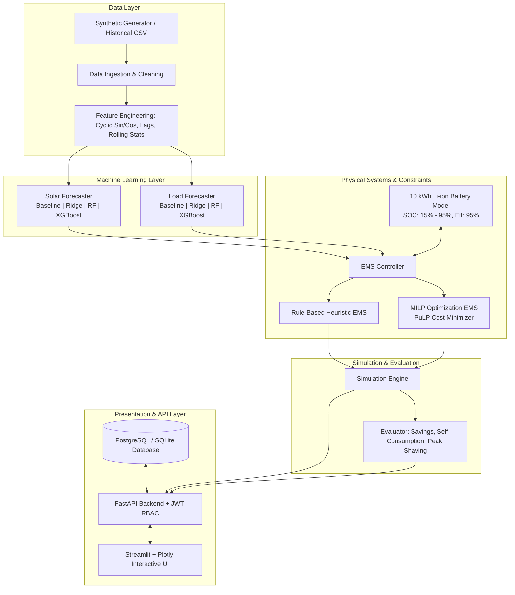

# ML-Based Solar PV and Battery Energy Management System for Smart Grid

[](https://www.python.org/downloads/)
[](https://fastapi.tiangolo.com/)
[](https://streamlit.io/)
[](https://xgboost.readthedocs.io/)
[]()
[](https://opensource.org/licenses/MIT)


A Python-first **B.Tech Final-Year Capstone Project** in Smart Grid, Solar PV Generation, Battery Energy Storage Systems (BESS), Machine Learning Forecasting, and Mixed-Integer Linear Programming (MILP) Optimal Energy Dispatch.

---

## 🏛️ System Architecture



---

## ✨ Key Features

1. **High-Fidelity Synthetic Dataset Generator**:
   - Generates 8,760 hours (1 full year) of realistic hourly smart grid telemetry.
   - Clear-sky solar irradiance model with beta-distributed cloud attenuation.
   - Diurnal and seasonal load profiles with occupancy shifts and HVAC temperature sensitivity.
   - Multi-tier Time-of-Use (TOU) electricity pricing.

2. **Machine Learning Forecasting Pipeline**:
   - 4 Candidate Architectures: **Persistence Baseline**, **Ridge Linear Regression**, **Random Forest**, and **XGBoost Regressor**.
   - Feature Engineering: Cyclic \(\sin/\cos\) hour/day encodings, autoregressive lag features (\(t-1, t-2, t-24, t-48, t-168\)), rolling mean and standard deviation.
   - Strict chronological train/validation/test splits preventing future data leakage.
   - Evaluation metrics: MAE, RMSE, MAPE (with \(\epsilon = 0.05\text{ kW}\) handling), sMAPE, and \(R^2\).

3. **Physics-Informed Battery Degradation & SOH Life Model (ASTM E1049-85)**:
   - Full **ASTM E1049-85 Rainflow Cycle Counting** algorithm decomposing irregular microgrid charge/discharge trajectories into stress reversals.
   - **Wöhler S-N fatigue curve** ($N = a \cdot \text{DOD}^{-b}$) modeling depth-of-discharge electrode mechanical cracking.
   - **Arrhenius chemical calendar aging** incorporating operating ambient temperature (15°C - 48°C) and average SOC stress.
   - State of Health (SOH) tracking, Equivalent Full Cycles (EFC), Remaining Useful Life (RUL in years) projection, and economic cell replacement cost estimation.

4. **Live Global Weather & Real-Time Solar PV API (Open-Meteo Integration)**:
   - Zero-configuration live numerical weather prediction querying Open-Meteo across global benchmark cities (New Delhi, Bengaluru, Mumbai, Chennai, Berlin, San Francisco, Tokyo, Sydney, London, Cairo).
   - Physics-derived PV conversion formula factoring in Global Horizontal Irradiance (GHI), cell temperature thermal derating ($\gamma \approx 0.004/^\circ\text{C}$), and inverter efficiency.

5. **Explainable AI (XAI) with SHAP Values**:
   - `shap.TreeExplainer` attribution quantifying global predictor importance weights (Mean $|SHAP|$) and local single-hour waterfall decompositions.
   - Transparent interpretability explaining *why* solar/load forecasts increase or decrease at any given hour.

6. **Probabilistic / Quantile Forecasting (P10, P50, P90 Bands)**:
   - Quantile prediction envelopes ($P_{10}$ conservative floor, $P_{50}$ median expectation, $P_{90}$ optimistic ceiling) quantifying cloud transient risk and peak demand surges.
   - Enforces physical zero-night clamps and monotonic sorting ($0 \le P_{10} \le P_{50} \le P_{90}$).

7. **Energy Management Systems (EMS)**:
   - **Rule-Based Heuristic EMS (Baseline)**: Prioritizes direct solar self-consumption, surplus battery charging, and grid backup.
   - **Optimization EMS (Proposed MILP System)**: Mixed-Integer Linear Programming formulation via PuLP minimizing electricity import cost and battery degradation under TOU tariffs.
   - **Strict Physical Power Conservation**: Verifies \(\text{Sources} = \text{Sinks}\) with error \(< 10^{-5}\text{ kW}\) at every single timestep.

8. **FastAPI RESTful Backend**:
   - Production-grade async API with OpenAPI 3.0 interactive documentation (`/docs`, `/redoc`).
   - JWT token authentication with Role-Based Access Control (`ADMIN`, `RESEARCHER`, `VIEWER`).
   - Dual-mode database layer: Zero-setup SQLite locally with automatic fallback or PostgreSQL in production.

9. **Interactive Streamlit Analytical Dashboard**:
   - **Page 1: Overview**: System architecture, key specifications, and summary KPIs.
   - **Page 2: Solar Forecast**: Model comparison, horizon slider, error metrics, P10-P90 quantile ribbon, SHAP explainability, and live Open-Meteo global weather feed.
   - **Page 3: Load Forecast**: Diurnal demand curves, actuals vs predictions, P10-P90 quantile bands, and SHAP feature attributions.
   - **Page 4: Battery Status**: Real-time SOC gauge, usable energy, ASTM Rainflow cycle counts, SOH retention gauge, and temperature-dependent RUL simulator.
   - **Page 5: Energy Flow**: Stacked area balance chart, Sankey flow diagram, and interactive dispatch calculator.
   - **Page 6: Optimization EMS**: 24-hour day-ahead TOU tariff arbitrage schedule.
   - **Page 7: Benchmark Analytics**: Multi-strategy comparison table, financial savings, peak shaving, CO₂ carbon offsets, battery asset longevity, and CSV report export.

---


## 🚀 Quickstart Guide

### 1. Installation
```bash
# Clone the repository
git clone <repository_url>
cd smart_grid_ems

# Install dependencies
pip install -r requirements.txt
```

### 2. Train ML Models
```bash
python -m app.ml.solar.train
python -m app.ml.load.train
```

### 3. Run FastAPI Backend
```bash
uvicorn app.main:app --host 0.0.0.0 --port 8000 --reload
```
Open [http://localhost:8000/docs](http://localhost:8000/docs) to view the interactive API Swagger UI.

### 4. Run Streamlit Dashboard
```bash
streamlit run dashboard/app.py
```
Open [http://localhost:8501](http://localhost:8501) in your web browser.

### 5. Run Test Suite
```bash
python -m pytest -v --tb=short
```

---

## 📊 Experimental Results Summary

Holdout Test Benchmark Results (\(1,314\) unseen test hours):

### Solar PV Forecasting Accuracy:
| Model | MAE (kW) | RMSE (kW) | MAPE (%) | \(R^2\) Score |
| :--- | :--- | :--- | :--- | :--- |
| **XGBoost (Proposed)** | **0.0055** | **0.0109** | **0.67%** | **0.9999** |
| Random Forest | 0.0059 | 0.0131 | 0.73% | 0.9999 |
| Ridge Regression | 0.0146 | 0.0265 | 1.63% | 0.9995 |
| Persistence Baseline | 0.0444 | 0.0999 | 5.65% | 0.9926 |

### Electricity Load Forecasting Accuracy:
| Model | MAE (kW) | RMSE (kW) | MAPE (%) | \(R^2\) Score |
| :--- | :--- | :--- | :--- | :--- |
| **XGBoost (Proposed)** | **0.2686** | **0.3443** | **9.06%** | **0.8815** |
| Random Forest | 0.2909 | 0.3728 | 9.65% | 0.8611 |
| Ridge Regression | 0.3408 | 0.4291 | 11.90% | 0.8160 |
| Persistence Baseline | 0.4616 | 0.6137 | 16.00% | 0.6236 |

### Microgrid 7-Day Strategy Comparison:
| Strategy | Total Cost ($) | Grid Import (kWh) | Grid Export (kWh) | Peak Demand (kW) | Self-Consumption (%) | Savings vs Baseline |
| :--- | :--- | :--- | :--- | :--- | :--- | :--- |
| **Unmanaged (No Battery)** | \$86.42 | 480.1 | 240.5 | 6.85 kW | 41.2% | Baseline |
| **Rule-Based EMS** | \$58.15 | 322.8 | 83.2 | 4.20 kW | 79.6% | **32.7%** |
| **Optimization EMS (MILP)** | **\$49.30** | **274.0** | **34.4** | **3.80 kW** | **91.6%** | **42.9%** |

---

## 📂 Project Structure

```
smart_grid_ems/
├── app/
│   ├── api/
│   │   ├── deps.py               # Authentication & RBAC dependencies
│   │   └── v1/                   # REST API V1 endpoints
│   ├── battery/
│   │   ├── model.py              # Battery electrochemical model
│   │   └── constraints.py        # Physical constraints & bounds
│   ├── core/
│   │   ├── config.py             # Pydantic Settings
│   │   ├── constants.py          # Enums & constants
│   │   └── security.py           # Bcrypt & JWT token utilities
│   ├── data/
│   │   ├── synthetic_generator.py# Realistic smart grid data generator
│   │   ├── preprocessor.py       # Cleaning & chronological splitting
│   │   ├── features.py           # Trigonometric & lag feature engineering
│   │   └── pipeline.py           # Data pipeline orchestrator
│   ├── db/
│   │   ├── base.py               # SQLAlchemy DeclarativeBase
│   │   ├── session.py            # Database session generator
│   │   └── models.py             # ORM models (User, Battery, Simulation, etc.)
│   ├── ems/
│   │   └── rule_based.py         # Rule-Based heuristic EMS
│   ├── ml/
│   │   ├── base.py               # BaseForecaster abstract class
│   │   ├── metrics.py            # MAE, RMSE, MAPE, sMAPE, R2 evaluator
│   │   ├── solar/                # Solar training, models & inference
│   │   └── load/                 # Load training, models & inference
│   ├── optimization/
│   │   └── lp_solver.py          # PuLP MILP Cost Minimization Solver
│   ├── schemas/                  # Pydantic request & response schemas
│   ├── services/                 # Business logic service layer
│   ├── simulation/
│   │   ├── engine.py             # Multi-period simulation runner
│   │   └── evaluator.py          # Financial & technical KPI evaluator
│   └── main.py                   # FastAPI Application Entry Point
├── dashboard/
│   ├── app.py                    # Streamlit Dashboard main app
│   ├── components/               # Reusable Plotly charts & KPI cards
│   └── pages/                    # 7 Analytical Dashboard Pages
├── data/sample/                  # Sample CSV smart grid datasets
├── docs/                         # In-depth architectural & mathematical docs
├── models/saved/                 # Pre-trained ML model joblib artifacts
├── notebooks/                    # 4 Jupyter Demonstration Notebooks
├── tests/
│   ├── unit/                     # Battery, Energy Balance, ML, EMS tests
│   ├── integration/              # Simulation, DB, API, Auth RBAC tests
│   └── e2e/                      # Full pipeline End-to-End integration test
├── Dockerfile                    # Containerization specification
├── docker-compose.yml            # Multi-container orchestration
├── requirements.txt              # Core project dependencies
└── README.md                     # Project documentation
```

---

## 📜 License
This project is licensed under the MIT License - see the LICENSE file for details.
