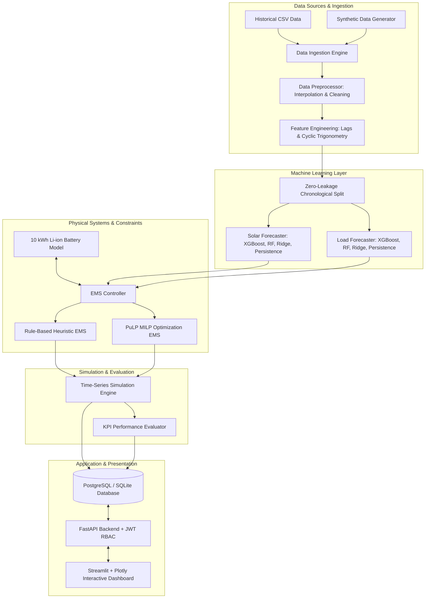

# System Architecture: Smart Grid Solar PV & Battery Energy Management System

## 1. Overview
The Smart Grid Energy Management System (EMS) is a multi-tier, data-driven platform designed to optimize microgrid power flows, reduce grid operating costs, maximize renewable self-consumption, and protect battery hardware health.

---

## 2. Component Layers

### Layer 1: Data Pipeline
- **Synthetic Generator**: Implements clear-sky irradiance formulas, cloud cover beta distributions, ambient temperature sinusoidal curves, and dual-peak residential/commercial load models.
- **Preprocessor**: Removes duplicate timestamps, performs time-based linear interpolation, and enforces physical boundaries.
- **Feature Engineer**: Computes \(\sin/\cos\) encodings for hour of day, day of week, day of year, plus autoregressive lags (\(t-1, t-2, t-24, t-48, t-168\)) and rolling statistics (\(6\text{h}, 24\text{h}\)).
- **Zero Leakage**: Enforces strict chronological train/val/test splits (\(70\% / 15\% / 15\%\)).

### Layer 2: Machine Learning Forecasting
- **Solar Models**: Persistence (t-24), Ridge Regression, Random Forest, XGBoost Regressor with zero-night forcing.
- **Load Models**: Persistence (t-24), Ridge Regression, Random Forest, XGBoost Regressor with minimum load floor.
- **Metrics**: MAE, RMSE, MAPE (with \(\epsilon = 0.05\text{ kW}\) handling), sMAPE, and \(R^2\).

### Layer 3: Physical Battery Model
- **Electrochemical Storage**: Tracks \(SOC_t \in [0.15, 0.95]\) with rated 0.5C power limits (5.0 kW max charge/discharge).
- **Efficiency**: \(95\%\) sub-efficiency for charging and discharging (combined roundtrip \(\approx 90.25\%\)).
- **Mutual Exclusivity**: Strict prohibition of simultaneous charging and discharging (\(P_{ch} \cdot P_{dis} = 0\)).

### Layer 4: Energy Management Systems (EMS)
- **Rule-Based EMS**: Direct solar to load \(\to\) surplus to battery \(\to\) surplus to grid; deficit to battery \(\to\) deficit to grid.
- **Optimization EMS**: MILP solver minimizing total net import cost + battery degradation over rolling 24-hour day-ahead horizons.

### Layer 5: Backend, API & Dashboard
- **FastAPI REST API**: OpenAPI 3.0 documented endpoints with JWT authentication and Role-Based Access Control (`ADMIN`, `RESEARCHER`, `VIEWER`).
- **Database**: Dual-compatible SQLAlchemy engine supporting SQLite (zero-setup local) and PostgreSQL (production).
- **Streamlit Dashboard**: Multi-page analytical UI with Plotly charts (Actual vs Predicted, Sankey diagrams, Stacked power area charts, TOU arbitrage curves).
